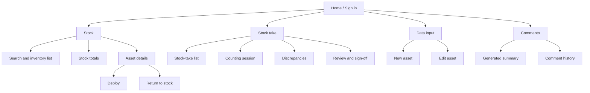
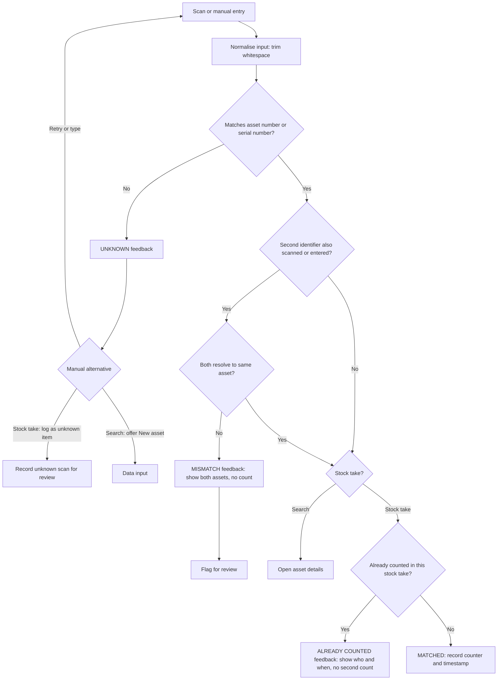
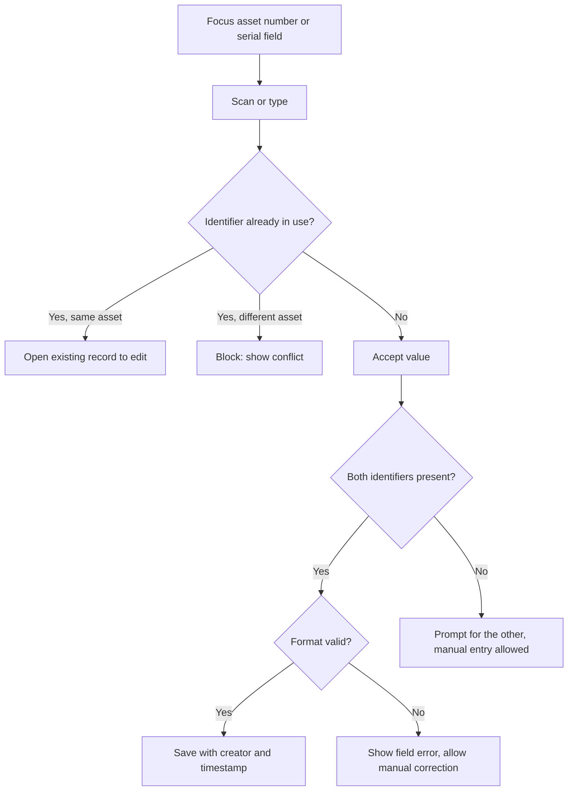
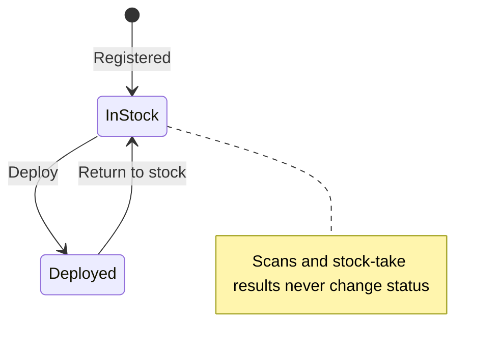
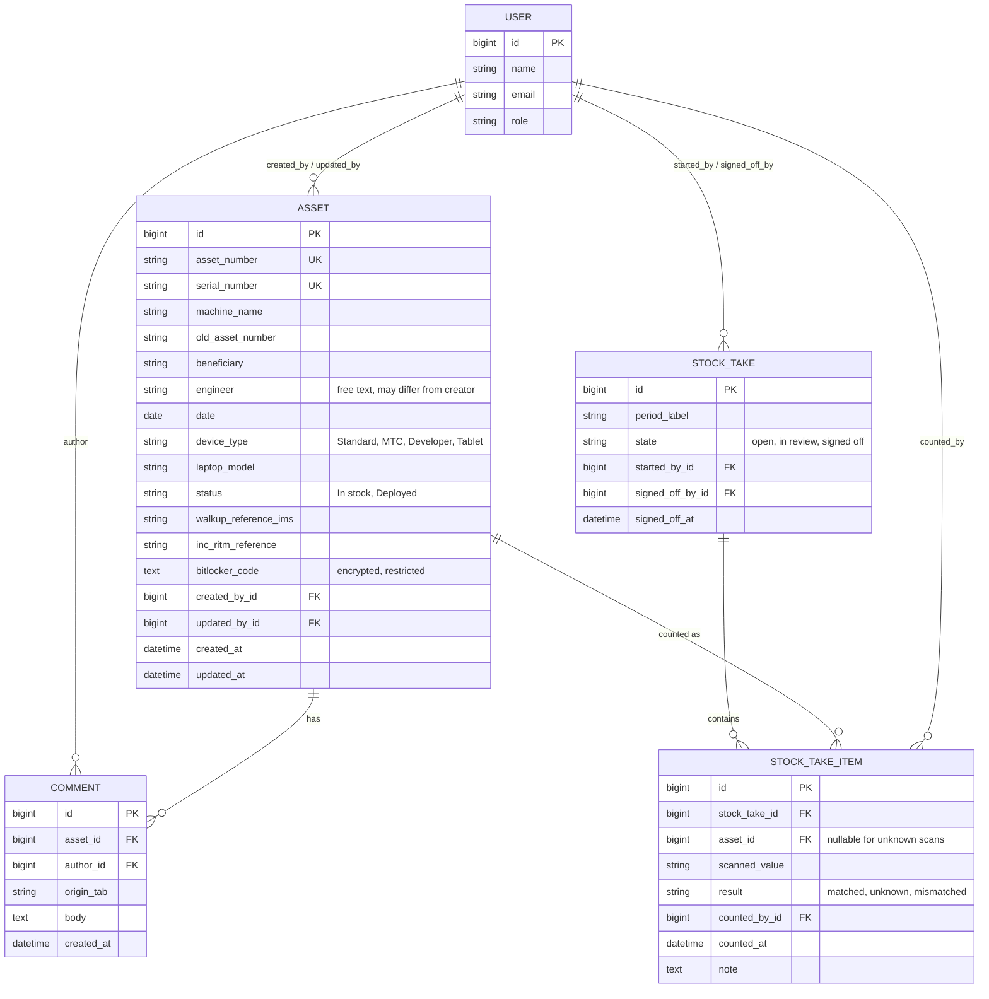

# ASSET Management: Design Pack

Responsive (desktop, tablet, mobile) Rails app for corporate laptop stock control. **Labels:** **\[Given\]** = from your brief. **\[Assumption\]** = my interpretation, needs confirming. **\[Suggestion\]** = proposal only.

## 1. Sitemap



Responsive note **\[Assumption\]**: tablet and mobile use one-column layouts; counting and search screens are touch-friendly with a persistent scan/search field.

## 2. User journeys

### 2.1 Receiving / registering a laptop

1. Data input, then New asset.
2. Scan or type asset number and serial number into their own fields (keyboard-mode scanner types into the focused field).
3. System checks both are unused. Duplicates are blocked with a link to the existing record.
4. Enter remaining fields (machine name, model, device type, optional ServiceNow refs, BitLocker code, etc.).
5. Save. Status defaults to **In stock** **\[Assumption\]**. Creator and timestamp recorded.

### 2.2 Barcode search

1. Focus the Stock search box and scan either barcode (or type it).
2. Exactly one match opens the asset details. No match shows "unknown". Scanning never changes status.

### 2.3 Deployment

1. Open an In-stock asset, choose Deploy.
2. Enter beneficiary, engineer, date, INC/RITM and walkup refs (as available).
3. Confirm. Status becomes **Deployed**, update logged by user and time. Optionally generate a comment summary (2.5).

### 2.4 Return to stock

1. Open a Deployed asset (found by scan or search), choose Return to stock.
2. Confirm. Status becomes **In stock**, with date, engineer and any reference updates recorded. Whether beneficiary is cleared or kept as history is an open question (section 6).

### 2.5 Editing and generating comments

1. Open asset, Comments tab (or the Comments area).
2. Choose Generate summary. Output uses *current* field values in this exact order:

```
INC/RITM Reference: [value]
Machine Name: [value]
Beneficiary: [value]
Asset number: [value]
Old asset number: [value]
Engineer: [value]
date: [value]
Type device: [value]
Model: [value]
```

3. Save it as a comment, or add a free-text comment. Each comment stores **author**, **timestamp** and **originating tab** as separate fields. The engineer shown in the text may differ from the author. BitLocker codes never appear.

### 2.6 Quarterly stock take

1. Authorised user creates a stock take for the period **\[Assumption: quarterly\]**.
2. Counters scan asset or serial barcodes (or enter manually). Each result shows matched, unknown, mismatched or already-counted. Who and when are recorded.
3. Reviewer opens Discrepancies (expected but not counted, counted but unknown, mismatches).
4. Reviewer resolves or notes each item, then signs off. Stock-take outcomes are stored apart from In stock/Deployed status and never change it.

## 3. Flow diagrams

### 3.1 Scan resolution (search and stock take)



### 3.2 Data input with scanning



### 3.3 Deploy / return status flow



## 4. Suggested Rails ERD **\[Suggestion\]**



Implementation notes **\[Suggestion\]**: unique index on `(stock_take_id, asset_id)` prevents double counting by either barcode; encrypt `bitlocker_code` with Rails Active Record Encryption; the engineer is a text field (not a User foreign key) because the engineer may not be an app user **\[Assumption\]**; keep stock-take result on `StockTakeItem`, never on `Asset.status`; consider an audit gem such as PaperTrail for update history.

## 5. Roles and permissions **\[Suggestion, not requirements\]**

| Capability | Viewer | Engineer | Stock controller | Admin |
| --- | --- | --- | --- | --- |
| Search, view assets (BitLocker masked) | Yes | Yes | Yes | Yes |
| Create / edit assets | No | Yes | Yes | Yes |
| Deploy / return to stock | No | Yes | Yes | Yes |
| Add comments, generate summary | No | Yes | Yes | Yes |
| Count in a stock take | No | Yes | Yes | Yes |
| Start stock take, review, sign off | No | No | Yes | Yes |
| Reveal BitLocker code | No | No | Restricted, logged | Restricted, logged |
| Export (excludes BitLocker) | No | No | Yes | Yes |
| Manage users and roles | No | No | No | Yes |

## 6. Open questions

1. Is "Q audit" quarterly? One stock take per quarter, or ad hoc ones too?
2. Who may reveal BitLocker codes, and should each reveal be logged?
3. Is ServiceNow integration wanted later? For now the references are plain text fields.
4. Are asset and serial formats fixed (for validation)? Can either be blank?
5. Does sign-off lock a stock take? Who may sign off, and can a second person be required?
6. On return to stock, are beneficiary, INC/RITM and engineer cleared or kept as history?
7. Is "date" the deployment date, the last-changed date, or something else?
8. Should the engineer be picked from a list or typed freely?
9. Can unknown scanned laptops be added to inventory from within a stock take?
10. Are there stock locations or sites to count separately?
11. Which scanner models are in use, and do they append Enter or a prefix?
12. How is sign-in handled (company SSO or local accounts)?
13. Are "old asset number" lookups required in search?

## 7. MVP vs future

**MVP**

- Sign-in, roles, responsive layouts
- Asset create/edit with the brief's fields and validations
- Search (asset or serial, keyboard-mode scanner), stock totals, asset details
- Deploy and return-to-stock
- Generated comment summary and attributed comment history
- Quarterly stock take: scan/manual count, feedback states, discrepancies, review, sign-off
- BitLocker masking, restriction, and exclusion from comments and ordinary exports
- Created/updated by and timestamps

**Future**

- Camera barcode scanning
- Live ServiceNow integration (unconfirmed)
- Reveal-event audit reporting, advanced exports
- Stock-take reminders and dashboards