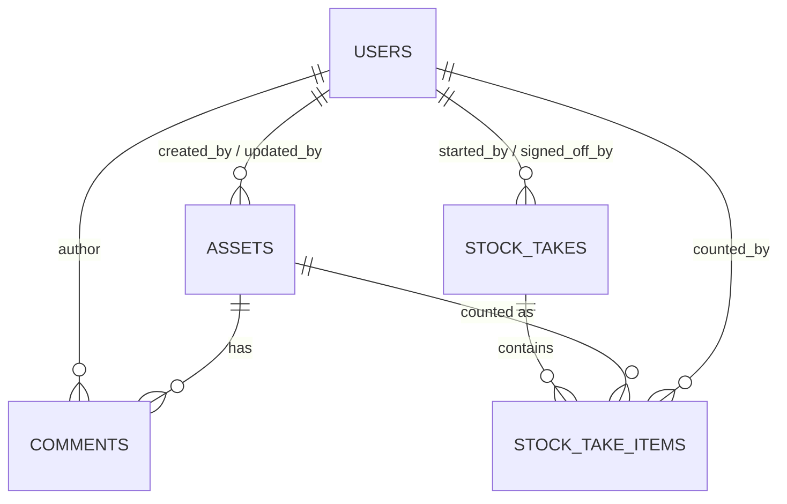

# ASSET Management: Database Model and Folder Structure

Ruby on Rails, PostgreSQL, Tailwind CSS. **Everything here is a suggested design** unless it comes straight from your brief. `[Assumption]` marks my interpretation.

## 1. Entity-relationship diagram



## 2. Tables

### users
| Column | Type | Null | Default | Notes |
|---|---|---|---|---|
| id | bigint | no | | PK |
| name | string | no | | |
| email_address | string | no | | unique, stored lowercase |
| password_digest | string | no | | `has_secure_password` (bcrypt) |
| role | string | no | `viewer` | `viewer`, `engineer`, `stock_controller`, `admin` (suggested) |
| created_at / updated_at | datetime | no | | |

### assets
| Column | Type | Null | Default | Notes |
|---|---|---|---|---|
| id | bigint | no | | PK |
| asset_number | string | no | | unique (case-insensitive check in model) |
| serial_number | string | no | | unique (case-insensitive check in model) |
| machine_name | string | yes | | |
| old_asset_number | string | yes | | |
| beneficiary | string | yes | | |
| engineer | string | yes | | free text; can differ from the record creator |
| date | date | yes | | `[Assumption]` meaning to be confirmed |
| device_type | string | no | `Standard` | `Standard`, `MTC`, `Developer`, `Tablet` |
| laptop_model | string | yes | | |
| status | string | no | `In stock` | `In stock`, `Deployed` |
| walkup_reference_ims | string | yes | | ServiceNow reference, plain text, no integration |
| inc_ritm_reference | string | yes | | ServiceNow reference, plain text, no integration |
| bitlocker_code | text | yes | | **encrypted** (Active Record Encryption), masked, restricted |
| created_by_id | bigint | yes | | FK to users |
| updated_by_id | bigint | yes | | FK to users |
| created_at / updated_at | datetime | no | | creation and update timestamps |

Notes: the brief's "comments" field is not a column; comments are the separate `comments` table. An asset number may not equal any other asset's serial number (and vice versa), so one scanned value can only resolve to one asset.

### comments
| Column | Type | Null | Notes |
|---|---|---|---|
| id | bigint | no | PK |
| asset_id | bigint | no | FK to assets |
| author_id | bigint | no | FK to users (the comment creator, not the engineer) |
| origin_tab | string | no | `Stock`, `Stock take`, `Data input`, `Comments` |
| body | text | no | generated summary or free text; never contains the BitLocker code |
| created_at / updated_at | datetime | no | created_at is the comment timestamp |

Author, timestamp and originating tab are three separate columns, as required.

### stock_takes
| Column | Type | Null | Default | Notes |
|---|---|---|---|---|
| id | bigint | no | | PK |
| period_label | string | no | | e.g. `Q4 2026` (`[Assumption]` quarterly) |
| state | string | no | `open` | `open`, `in_review`, `signed_off` |
| started_by_id | bigint | no | | FK to users |
| signed_off_by_id | bigint | yes | | FK to users |
| signed_off_at | datetime | yes | | |
| review_notes | text | yes | | |
| created_at / updated_at | datetime | no | | |

### stock_take_items
| Column | Type | Null | Notes |
|---|---|---|---|
| id | bigint | no | PK |
| stock_take_id | bigint | no | FK to stock_takes |
| asset_id | bigint | yes | FK to assets; empty for unknown and mismatched scans |
| scanned_value | string | no | what was scanned or typed |
| result | string | no | `matched`, `unknown`, `mismatched` |
| counted_by_id | bigint | no | FK to users: who counted |
| counted_at | datetime | no | when counted |
| note | text | yes | e.g. mismatch explanation |
| created_at / updated_at | datetime | no | |

The stock-take outcome lives only here, never on `assets.status`.

## 3. Indexes and constraints
| Table | Index / constraint | Purpose |
|---|---|---|
| users | unique `email_address` | one account per email |
| assets | unique `asset_number`; unique `serial_number` | no duplicate laptops |
| assets | index `created_by_id`, `updated_by_id` | audit lookups |
| comments | index `asset_id`, `author_id` | history per asset |
| stock_take_items | unique `(stock_take_id, asset_id)` | **a laptop is counted once per stock take, whichever barcode is scanned** (empty `asset_id` values are allowed repeatedly in PostgreSQL) |
| stock_take_items | index `stock_take_id`, `asset_id`, `counted_by_id` | review queries |
| all FKs | foreign key constraints | referential integrity |

## 4. Model rules
- **Asset:** presence of asset and serial number; `device_type` and `status` limited to the lists above; BitLocker code encrypted.
- **Lookup:** one case-insensitive search across `asset_number` and `serial_number` finds the asset from either barcode. It is read-only, so scanning never changes status.
- **StockTake:** only `open` takes accept counts; flow `open` to `in_review` to `signed_off`.
- **Discrepancies** (`[Assumption]` "expected" = currently In stock): expected but not counted; counted but recorded as Deployed; unknown scans; mismatched scans.
- **Permissions (suggested):** viewer reads; engineer edits, deploys, comments, counts; stock controller also runs stock takes, exports and reveals BitLocker; admin everything.

## 5. Code folder structure

```
asset_management/
├── app/
│   ├── controllers/
│   │   ├── application_controller.rb     # login check, permission helper
│   │   ├── sessions_controller.rb        # sign in / out
│   │   ├── assets_controller.rb          # Stock + Data input: index, show, new/create, edit/update, deploy, return_to_stock, bitlocker, CSV
│   │   ├── comments_controller.rb        # Comments area: index, new (generate), create
│   │   └── stock_takes_controller.rb     # index, new/create, show, scan, finish_counting, sign_off
│   ├── models/
│   │   ├── user.rb
│   │   ├── asset.rb                      # validations, lookup, search, encryption
│   │   ├── comment.rb
│   │   ├── stock_take.rb                 # record_scan, discrepancies
│   │   └── stock_take_item.rb
│   ├── services/
│   │   ├── scan_resolver.rb              # matched / unknown / mismatched
│   │   ├── comment_generator.rb          # exact comment format
│   │   └── asset_csv.rb                  # export without BitLocker
│   ├── helpers/
│   │   └── application_helper.rb         # shared styles, date formats
│   ├── javascript/
│   │   └── controllers/
│   │       └── scan_field_controller.js  # scanner Enter moves to next field
│   └── views/
│       ├── layouts/application.html.erb  # responsive nav
│       ├── sessions/new.html.erb
│       ├── assets/                       # index, show, new, edit, _form, bitlocker
│       ├── comments/                     # index, new
│       └── stock_takes/                  # index, new, show
├── config/
│   ├── routes.rb
│   └── initializers/
│       └── active_record_encryption.rb   # BitLocker encryption keys from environment
├── db/
│   ├── migrate/                          # creates the five tables
│   ├── schema.rb                         # generated
│   └── seeds.rb                          # first admin user
├── test/
│   ├── models/stock_take_test.rb
│   └── services/comment_generator_test.rb
├── Gemfile                               # rails, pg, tailwindcss-rails, bcrypt, csv
├── BLUEPRINT.md                          # daily MVP plan
└── README.md
```

Everything not listed (bin/, public/, Dockerfile, etc.) is generated by `rails new`.

## 6. Routes (summary)
| Area | Routes |
|---|---|
| Sign-in | `GET/POST /session/new`, `DELETE /session` |
| Stock and Data input | `/assets` (index, show, new, create, edit, update), `PATCH /assets/:id/deploy`, `PATCH /assets/:id/return_to_stock`, `GET /assets/:id/bitlocker`, `GET /assets.csv` |
| Comments | `GET /comments`, `GET/POST /assets/:asset_id/comments/new` and `/comments` |
| Stock take | `/stock_takes` (index, new, create, show), `POST .../scan`, `PATCH .../finish_counting`, `PATCH .../sign_off` |

## 7. Open points affecting the model
1. Should a reveal of a BitLocker code be logged? (would add an audit table)
2. Should return to stock clear beneficiary, or keep it as history?
3. Is "expected" in a stock take only In stock assets, or also Deployed?
4. Do stock takes need locations or sites? (not in the brief, so not modelled)
5. Meaning of the `date` field.
